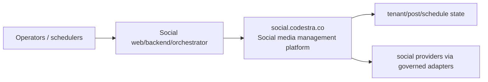
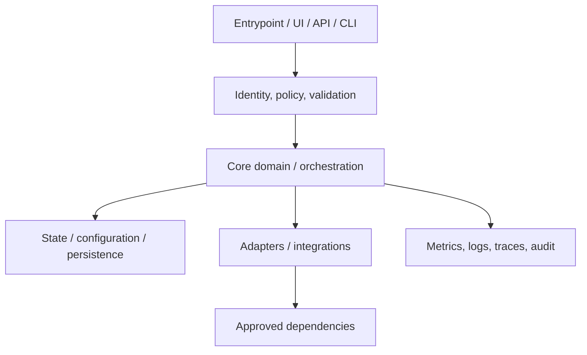
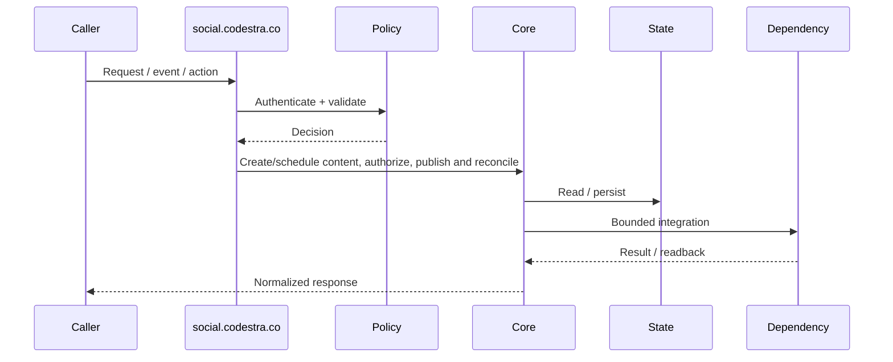
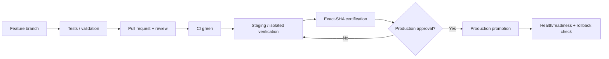
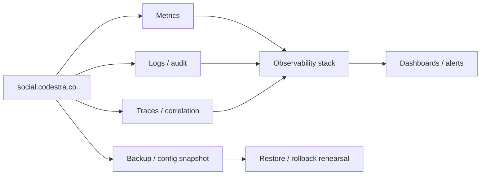

# social.codestra.co — Architecture Charts

> Repository: `appolon1908/social.codestra.co`  
> Baseline branch: `main`  
> Repository-local visual architecture. Update with code, contracts, ownership and deployment changes.

## 1. System context

## 2. Internal component architecture

## 3. Critical flow

## 4. Deployment and promotion

## 5. Observability and recovery

## Ownership notes
- **Role:** Social media management platform
- **Primary boundary:** Social web/backend/orchestrator
- **State/config:** tenant/post/schedule state
- **Dependencies/consumers:** social providers via governed adapters
- Cross-repository effects must use reviewed contracts; production effects remain separately gated.
